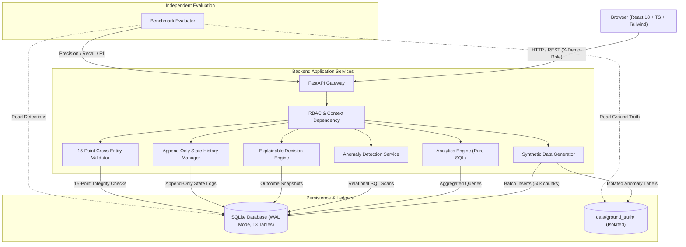

# Cohortly – System Architecture & Technical Design

This document details the high-level architecture, subsystem boundaries, data flows, and performance characteristics of **Cohortly – Learning Analytics & Cohort Intelligence Platform**.

---

## 1. Architectural Philosophy

Cohortly is architected according to three core tenets:
1. **Explainability Over Mere Display**: Instead of isolated dashboard graphs, every metric and data quality anomaly is backed by structured evidence, the citing business rule, and actionable remediation workflows.
2. **Absolute Ground-Truth Isolation**: Operational analytics, anomaly detection, and APIs operate strictly against source relational data. Ground truth edge-case labels are stored in an isolated ledger and used strictly by independent benchmark evaluation modules to evaluate detection precision and recall.
3. **Deterministic Reproducibility & Performance at Scale**: With a fixed seed (`20261022`) and a deterministic reference clock, identical datasets and bitwise identical SHA-256 exports are produced across independent runs. The pipeline supports scaling up to 2,000,000 activity events through SQLite WAL mode, multi-column B-tree indexes, chunked batching, and SQL aggregations.

---

## 2. System Subsystems & Data Flow



---

## 3. Two-Tier Deduplication Architecture & Analytics Policy

1. **Exact Deduplication (Idempotency Key)**:
   - Evaluated using a deterministic SHA-256 hash across six fields: `(learner_id, course_id, content_id, event_type, session_id, event_timestamp_utc)`.
   - The first ingested event is retained as canonical; subsequent duplicate records are retained in the raw ledger and **automatically excluded from engagement analytics**.
2. **Near-Duplicate Detection (Retry Window) & Analytics Inclusion Policy**:
   - Scans for events with identical context occurring within $\le 5.0\text{ seconds}$ of each other.
   - Preserves events while flagging them as candidates in the Exceptions ledger for investigation.
   - **Crucial Policy**: Potential near-duplicates are **NOT** automatically excluded from engagement metrics unless an explicit review or policy confirms they are duplicates. This prevents artificial censorship of legitimate rapid repeated interactions (e.g. video scrubbing, rapid clicks).

---

## 4. Explainable Outcome Versioning Architecture

To support auditable course completion decisions:
- The `course_outcomes` table supports historical versioning with an incremental `outcome_version` counter and `supersedes_outcome_id` pointer.
- When an outcome is recalculated, the previous snapshot has `is_current` set to `0`.
- The new snapshot records the exact decision checklist in `outcome_reason`:
  ```json
  {
    "content_completion_pct": 85.0,
    "content_threshold": 80.0,
    "content_passed": true,
    "final_score": 78.5,
    "score_threshold": 70.0,
    "score_passed": true,
    "mandatory_assessments": {
      "total": 3,
      "passed": 3,
      "failed_ids": []
    },
    "decision": "COMPLETED",
    "reason": "All completion rule requirements (Version 1) satisfied."
  }
  ```

---

## 5. Performance Strategy for 2 Million Events

1. **Database Pragmas**:
   - Write-Ahead Logging (`PRAGMA journal_mode = WAL;`) allowing concurrent reads during bulk writes.
   - Asynchronous cache tuning (`PRAGMA cache_size = -64000;`, 64MB memory cache).
   - Normal synchronization mode (`PRAGMA synchronous = NORMAL;`).
2. **Batch Insertion Pipeline**:
   - Ingestion is executed in streaming chunks of 50,000 rows per transaction commit via `sqlite3.executemany()`.
3. **Pure SQL Aggregation**:
   - API endpoints calculate weekly activity, pass rates, and completion trends via SQL `GROUP BY` and window functions, avoiding loading unpaginated rows into Python memory.
4. **Pagination & Streaming**:
   - List endpoints enforce default limits of 50 records (max 200).
   - Data exports stream CSV and JSON directly to the client with `StreamingResponse`.

---

## 6. Role-Aware Experience & Demo Boundaries

- **Demo Role Switcher**: A header widget allows immediate toggling between:
  - `LEARNER`: Personal progress, course checklist, assessment scores.
  - `INSTRUCTOR`: Assigned courses, student progress, content drop-offs.
  - `ACADEMIC_ADMIN`: Cohort comparisons, program retention, graduation rates.
  - `SUPPORT_STAFF`: At-risk learners, inactive student triage, anomaly resolution.
  - `PLATFORM_ADMIN`: System-wide access, generator controls, validation audits.
- **Enforcement**: Backed by FastAPI route dependencies inspecting `X-Demo-Role` headers.
- **Boundaries & Security Limitations**:
  - `X-Demo-Role` is strictly a client-controlled demonstration mechanism to evaluate multi-persona visibility without requiring external OAuth/SSO setup in a local evaluation environment.
  - It does **not** provide cryptographic signature verification, session encryption, password salting, or token revocation.
  - In production, this architecture would be backed by OAuth2 / OpenID Connect (OIDC) Bearer JWT tokens, signed by an enterprise identity provider (Okta, Auth0, Keycloak) with role claims verified cryptographically.
